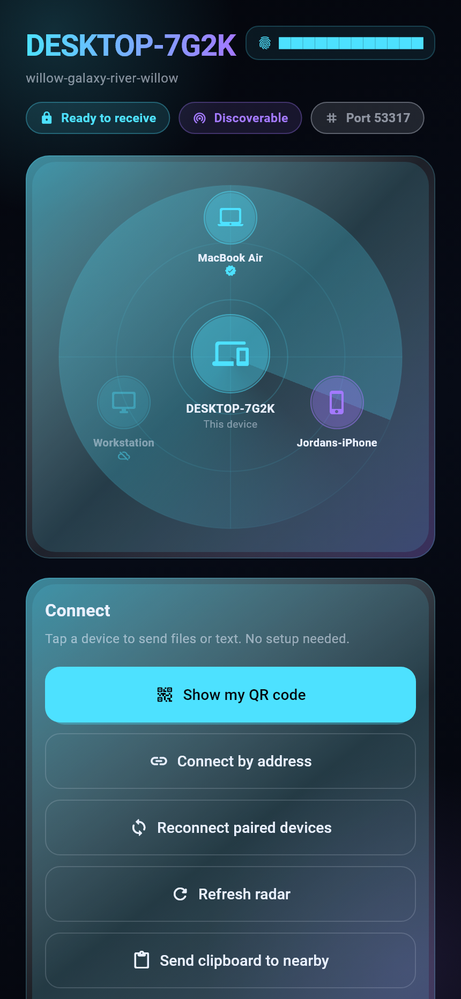
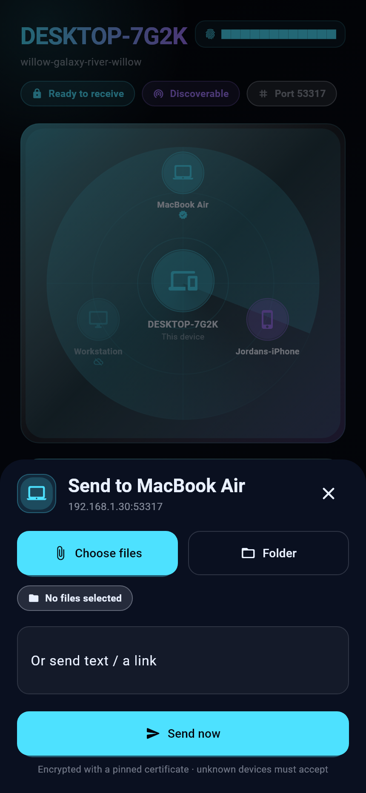
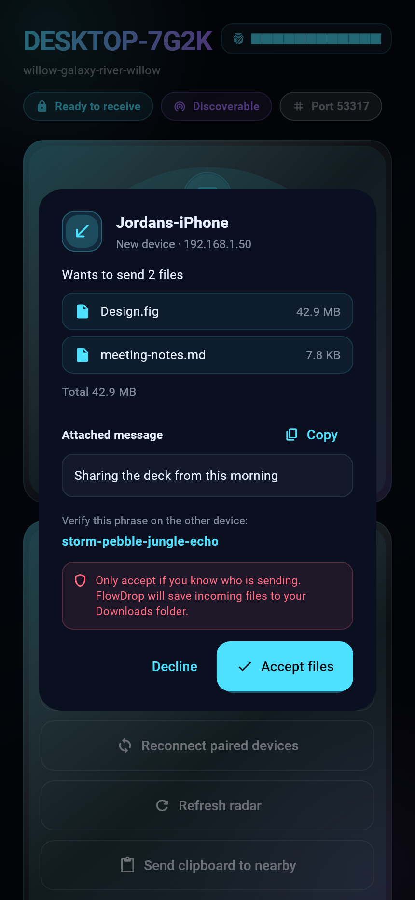
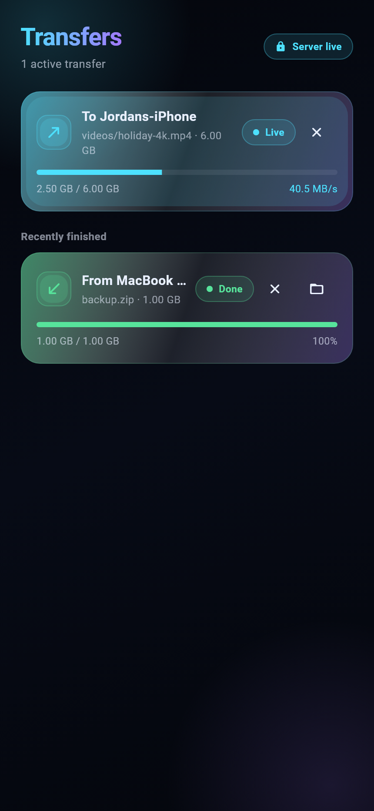
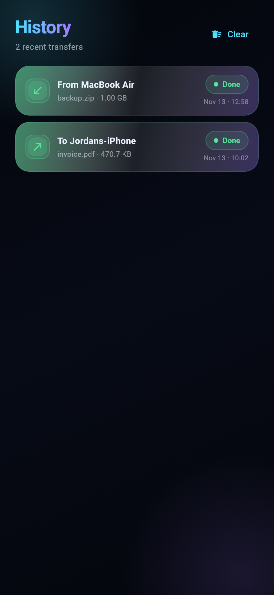
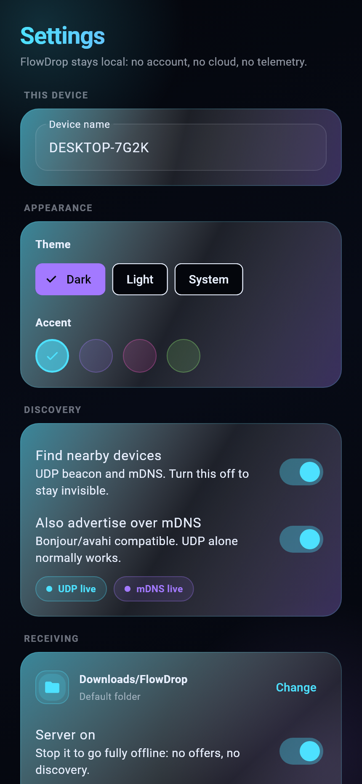
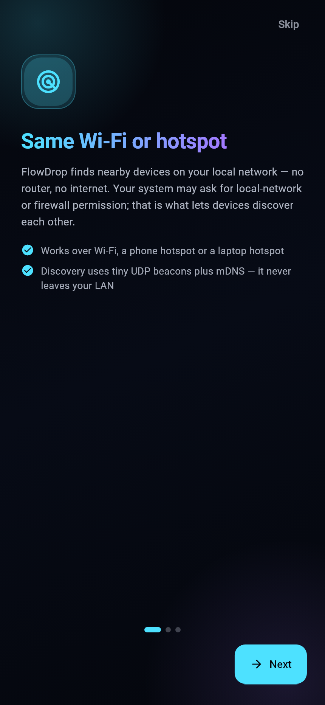

# FlowDrop

Fast, secure, LAN file and text transfer between any two devices — phone ↔ laptop, laptop ↔ laptop, phone ↔ phone — with **no account, no internet and no cloud**.

FlowDrop runs a small pinned-certificate HTTPS server on each device. Devices discover each other on the local network (mDNS + UDP fallback) or pair by QR code / manual address, and then stream files with SHA-256 verification, resume and parallel uploads.

- **Platforms:** Android, iOS, Windows, Linux, macOS
- **Stack:** Flutter (Dart), Riverpod, shelf HTTPS server, Ed25519 + self-signed TLS with fingerprint pinning
- **Security:** TLS everywhere, unknown senders always require explicit confirmation, path traversal is rejected, pairing tokens are single-use and expire in 2 minutes
- **Stays connected:** a paired device remains on your radar after app restarts and Wi-Fi changes, and reconnects automatically

## Screenshots

| Nearby radar | Send sheet | Incoming offer |
|:---:|:---:|:---:|
|  |  |  |

| Transfers | History | Settings |
|:---:|:---:|:---:|
|  |  |  |

<p align="center">
  
</p>

## Download

Grab the artifact for your OS from the
[latest release](https://github.com/cyberhatc/flowdrop/releases/latest):

| OS | Asset |
|---|---|
| Windows | `flowdrop-windows.zip` → run `flowdrop.exe` |
| Linux | `flowdrop-linux.tar.gz` → run `flowdrop` |
| macOS | `FlowDrop-macos.zip` → open `flowdrop.app` |
| Android | `app-release.apk` (sideload) or `app-release.aab` (Play Store) |
| iOS | build from source (`flutter build ios`) — App Store signing is not published |

The desktop archives are unsigned, so Windows SmartScreen and macOS Gatekeeper
will ask for confirmation the first time. That is expected for an OSS build.

## How to run

```bash
flutter pub get
flutter run            # desktop or mobile device
flutter test           # full unit + integration suite
```

## Connection methods

| Method | How | Notes |
|---|---|---|
| Same Wi-Fi / hotspot | UDP beacon + mDNS discovery (radar view) | No internet needed; hotspot = same code path |
| QR code | FlowDrop → **Show my QR** → scan/paste on the other device | Works even when discovery is blocked |
| Manual | IP : port + short fingerprint | Fallback for locked-down networks |

Large data always moves over the LAN. Bluetooth is not used for file transfer; see `docs/ARCHITECTURE.md` for why.

## Staying connected

A device you paired with is remembered as a **first-class peer**, not as a
one-off connection:

- Its last known addresses, port and last-seen time are persisted in the trust
  store, so the endpoint survives app restarts and DHCP changes.
- Paired devices are pinned on the radar: they are dimmed when offline instead
  of vanishing, and can be tapped again as soon as they are back.
- While a paired device is offline, FlowDrop probes it over HTTPS every 10 s
  (30 s backoff after a miss), trying every remembered address and the default
  port. The moment it answers, the radar entry goes live and the fresh
  endpoint is saved.
- A transfer or clipboard push also tries all known endpoints, so a device
  that moved from Wi-Fi to hotspot keeps working without re-pairing.
- Hidden / discovery-off mode still keeps a passive registry, so paired
  devices remain reachable by address even when this device is invisible.

If a paired device is on a different network, tap **Reconnect paired devices**
on the home screen (or the sync button next to it in Settings) once both are
back on the same LAN.

## Large files

There is no practical size limit — the cap is 1 TiB per file and, in reality,
the receiver's free disk space.

- Uploads stream from disk to socket in 64 KiB chunks; nothing is buffered in
  memory, so a 10 GB file uses the same RAM as a 10 MB one.
- SHA-256 is computed incrementally while streaming and verified by the
  receiver before the file is renamed from `.part` to its final name.
- Interrupted transfers resume from the received byte offset instead of
  restarting: the sender retries once automatically, and a reconnect during
  the same transfer negotiates the offset with the receiver.
- The receive socket stays open through short stalls (10-minute idle
  timeout), so a brief Wi-Fi hiccup does not abort a multi-GB upload.
- Staging files live under `<downloads>/.flowdrop_incoming/<sessionId>/` and
  are cleaned up on completion and after 24 h if abandoned.
- Deep folder transfers are shortened on Windows to stay under the 260-char
  path limit.

## Security model

- Each device generates an Ed25519 identity key and a self-signed TLS certificate on first run (private key in OS secure storage).
- Clients **pin** the certificate fingerprint — TLS verification is never blanket-disabled.
- Unknown devices always get an Accept / Decline prompt with file count, total size and a 4-word fingerprint phrase to verify out-of-band.
- Pairing tokens are 144-bit, single-use, expire after 2 minutes and are rate-limited per IP (5/min).
- Files are written to `.part` staging files and renamed only after size + SHA-256 verify; all names/paths are sanitized.

See `docs/PROTOCOL.md` for the wire protocol so others can build compatible clients.

## Build from source

- Requires Flutter 3.29+ / Dart 3.7+.
- Desktop builds: `flutter build windows|linux|macos`
- Mobile builds: `flutter build apk|appbundle|ios`

## Troubleshooting

- **Peers never appear:** allow the app through your firewall (default port 53317/TCP, 53318/UDP), avoid guest Wi-Fi with AP/client isolation, or use a phone hotspot + QR.
- **A paired device shows as offline:** make sure FlowDrop is open on it and both are on the same network, then tap **Reconnect paired devices**. Paired devices are probed automatically every 10 s.
- **A transfer stopped halfway:** FlowDrop retries once from the received byte offset automatically. If it still fails, send the file again once both devices are back on the same network.
- **QR pairing fails:** check that both devices show the same 4-word phrase; codes expire after 2 minutes and can be used once.
- **iOS receiving:** the server only runs while the app is foregrounded (iOS suspends sockets in the background) — keep FlowDrop open during transfers.

## Contributing

See `CONTRIBUTING.md`. Please run `flutter analyze` and `flutter test` before submitting — CI fails on warnings.

## License

MIT — see `LICENSE`.
